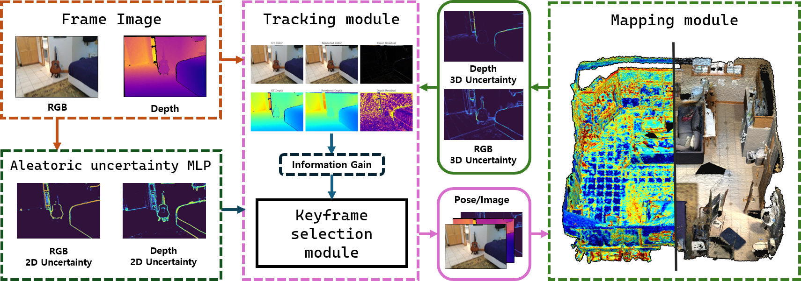

<div align=center>

# BayesianGS-SLAM: Uncertainty-Aware Neural Rendering SLAM via Probabilistic Formulation

  <p align="center">
    <a href="https://sites.google.com/view/thithin/"><strong>Kyeongsu Kang</strong></a>
    ·
    <a href="https://riboha.github.io/"><strong>Seongbo Ha</strong></a>
    ·
    <a href="https://sibaek-lee.github.io/"><strong>Sibaek Lee</strong></a>
    ·
    <a href="https://bogus2000.github.io/"><strong>Hyeonwoo Yu</strong></a>
  </p>


<h3 align="center"> IEEE Robotics and Automation Letters, 2026 </h3>

 [Paper](https://ieeexplore.ieee.org/document/11727033) | [ArXiv](https://arxiv.org/abs/2609.24140) | [Video](https://www.youtube.com/watch?v=6AhWxyfViuA)

</div>

## Overview



This branch renders with an omnidirectional (equirectangular) Gaussian
rasterizer: 360° spherical projection, spherical EWA covariance, per-splat RGB
variance, and analytic SE(3) camera-pose Jacobians.

## Environment

### Clone the repository

```bash
git clone --recurse-submodules https://github.com/Lab-of-AI-and-Robotics/BayesianGS-SLAM.git
cd BayesianGS-SLAM
```

For an existing checkout, initialize the submodules with `git submodule update --init --recursive`.

### Create the Conda environment

```bash
conda env create -f environment.yml -n bayesiangs-slam
conda activate bayesiangs-slam
```

### Install the local dependencies


```bash
python -m pip install setuptools wheel ninja
python -m pip install --no-build-isolation ./thirdparty/simple-knn
python -m pip install --no-build-isolation ./thirdparty/omni-gaussian-rasterization-w-pose-var
python -m pip install -e ./thirdparty/Hierarchical-Localization
```

> The vendored `omni-gaussian-rasterization-w-pose-var` package replaces the
> previous perspective rasterizers. It provides the 360° equirectangular
> projection, spherical EWA covariance, per-splat RGB variance, and analytic
> SE(3) pose Jacobians used by this branch.

## Omnidirectional data

All rendering and depth supervision in this branch is omnidirectional. The
pipeline expects a **2:1 equirectangular** RGB image and a depth map storing the
**Euclidean radial distance** from the camera centre (not a perspective z
value).

A generic sequence uses `dataset_name: "omni"` and the following layout:

```
<data.input_path>/
  rgb/           frame000000.png, frame000001.png, ...
  depth/         frame000000.png, frame000001.png, ...   # radial depth
  poses.txt      # one camera-to-world pose per line
```

`poses.txt` accepts one of:

- 16 row-major values (4×4 camera-to-world),
- 12 row-major values (3×4 camera-to-world),
- 8 values `timestamp tx ty tz qx qy qz qw`,
- 7 values `tx ty tz qx qy qz qw`.

Replica-style panoramic data uses `dataset_name: "replica360"` and the usual
`results/frame*.jpg`, `results/depth*.png`, `traj.txt` layout. Because panoramic
images are resized to `cam.W × cam.H`, keep the configured resolution 2:1.

The projection convention matches the rasterizer exactly:

```
lon = atan2(x, z)
lat = atan2(-y, sqrt(x^2 + z^2))
u   = (lon / pi + 1) * W / 2
v   = (0.5 - lat / pi) * H
```

### Depth uncertainty

The rasterizer produces per-splat **RGB** variance. Depth variance is therefore
not a native output; the pipeline uses the channel-averaged RGB variance as an
epistemic proxy (`render_depth_variance = variance.mean(dim=0)`), while the
learnable sensor-uncertainty MLP supplies the metric scale. This is a modelling
choice, not a calibrated depth covariance.

## Run

```bash
bash auto_base.sh 
```

or 

```bash
python run_slam.py /PATH/TO/CONFIG.yaml --keyframe_count 4
```

Example panoramic configs live in `configs/Omni/`:

```bash
python run_slam.py configs/Omni/example.yaml
python run_slam.py configs/Omni/replica360.yaml
```

Evaluation:

```bash
python run_evaluation.py --checkpoint_path /PATH/TO/RUN
python run_evaluation.py --checkpoint_path /PATH/TO/RUN --novel_view_render
```

Reconstruction evaluation accumulates spherical RGB-D unprojections into
`mesh/reconstructed_pointcloud.ply` and optionally a Poisson mesh; perspective
TSDF fusion is not used for panoramas.

### Rasterizer API

`render_gaussian_model` returns `color [3,H,W]`, `depth/alpha [H,W]`,
`variance [3,H,W]`, `render_color_variance [3,H,W]`, `render_depth_variance
[1,H,W]`, plus the per-splat `psi/lat/lon/n_touched` auxiliaries. Pose
optimisation passes zero-initialised SE(3) leaves `theta` (rotation) and `rho`
(translation); the renderer evaluates `T_CW = Exp([rho, theta]) @ T_CW_ref` and
writes `dL/dtheta`, `dL/drho` back into the leaves.


## Acknowledgement

Our implementation builds upon [LoopSplat](https://github.com/GradientSpaces/LoopSplat), [Gaussian-SLAM](https://vladimiryugay.github.io/gaussian_slam/index.html), and [VarSplat](https://github.com/anhthuan1999/varsplat).

## Citation

```bibtex
@article{kang2026bayesiangs,
  title={BayesianGS-SLAM: Uncertainty-Aware Neural Rendering SLAM via Probabilistic Formulation},
  author={Kang, Kyeongsu and Ha, Seongbo and Lee, Sibaek and Yu, Hyeonwoo},
  journal={IEEE Robotics and Automation Letters},
  year={2026},
  publisher={IEEE}
}
```

```bibtex
@misc{kang2026bayesiangsslamuncertaintyawareneuralrendering,
      title={BayesianGS-SLAM: Uncertainty-Aware Neural Rendering SLAM via Probabilistic Formulation}, 
      author={Kyeongsu Kang and Seongbo Ha and Sibaek Lee and Hyeonwoo Yu},
      year={2026},
      eprint={2609.24140},
      archivePrefix={arXiv},
      primaryClass={cs.RO},
      url={https://arxiv.org/abs/2609.24140}, 
}
```
